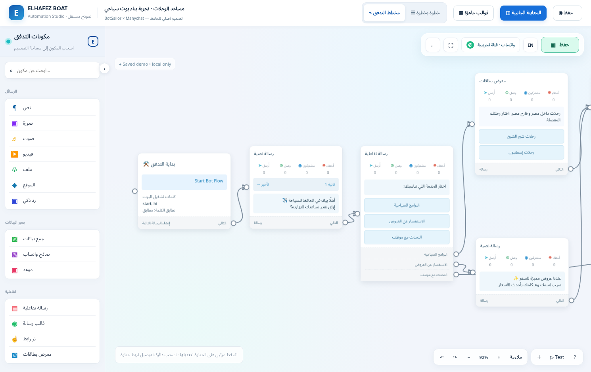
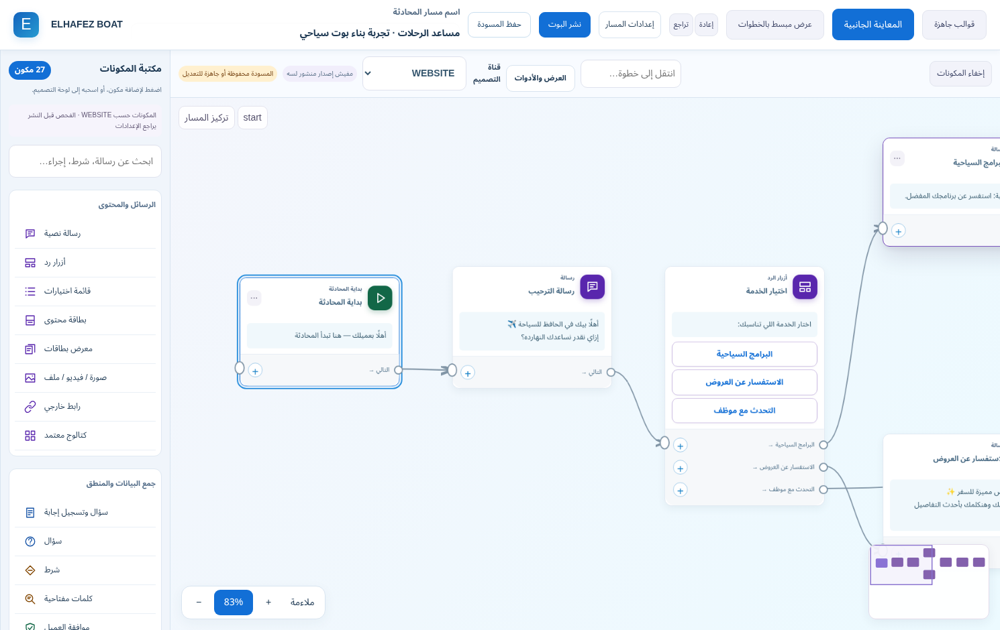
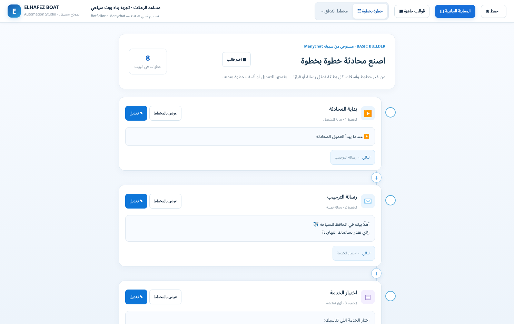
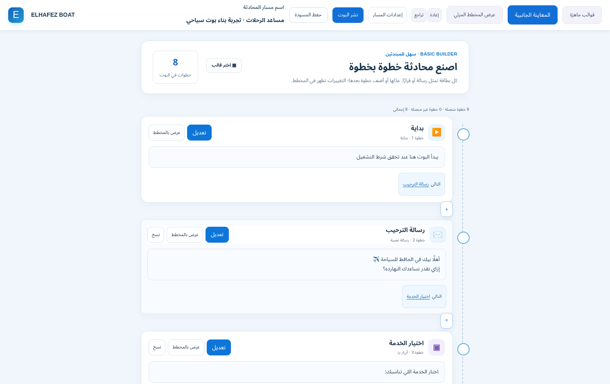

# Approved reference versus authenticated implementation

Both desktop captures use **1490×940**. Reference images render the supplied approved HTML, checksum `9fbca0448e1e0a07f6c5dc6b1008b324bd8de6f7fc787c9cf5fa0328547d0b1b`. App images show the real modified platform with synthetic authenticated data. Reference and application use their respective representative graphs, so this is a layout/interaction comparison, not a numerical pixel-difference claim.

| View | Approved reference only | Modified application |
| --- | --- | --- |
| Advanced Canvas |  |  |
| Basic Builder |  |  |

The app now follows the reference's left grouped library, open canvas, white message cards, visible ports/curved edges, white-and-blue controls, sequential Basic cards and insert-between affordance. Its real validation/publish/history controls, semantic icons and node metadata remain visible. The original prototype's demo engine and fake local persistence were not copied.

## Actual app evidence

- [Grouped searchable library](../../evidence/hybrid-approved-2026-10-22/03-component-library.png)
- [Message Inspector](../../evidence/hybrid-approved-2026-10-22/04-message-editor.png)
- [Three-button editor and destinations](../../evidence/hybrid-approved-2026-10-22/05-buttons-editor.png)
- [Condition/branch editor](../../evidence/hybrid-approved-2026-10-22/06-condition-editor.png)
- [Connected-step insertion](../../evidence/hybrid-approved-2026-10-22/07-insert-step.png)
- [Docked server-backed conversation preview](../../evidence/hybrid-approved-2026-10-22/08-side-preview.png)
- [Mobile Basic](../../evidence/hybrid-approved-2026-10-22/09-mobile.png)
- [Saved and reopened bot](../../evidence/hybrid-approved-2026-10-22/10-saved-reopened.png)
- [Mobile conversation preview](../../evidence/hybrid-approved-2026-10-22/11-mobile-preview.png)

Owner visual approval and physical-device review remain pending. These screenshots do not prove every component or external integration works; see [actual test scope and limitations](REVIEW.md).
